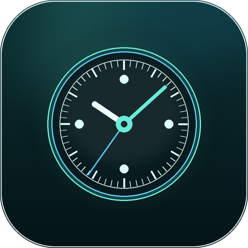

# Desktop Clock for DeepSeek Harness

[](https://github.com/topics/dsh-plugin)
[](LICENSE)

A polished, draggable floating clock for the DeepSeek Harness Web GUI. It gives the workspace a real desk-clock presence without taking over the interface: analog and digital faces, a focus timer, four themes, and a position it remembers.



## 功能

- **三种表盘**：数字、指针、组合；指针支持平滑走秒。
- **专注计时**：5 / 15 / 25 / 45 分钟预设，开始、暂停、继续、重置，结束提示音；刷新页面后仍在计时。
- **桌面化交互**：拖动标题栏移动，双击标题栏折叠，位置可锁定；`Alt + Shift + D` 随时显示或隐藏。
- **四套主题**：极光、余烬、亚麻、石墨，均带完整明暗对比与玻璃质感。
- **细节设置**：12/24 小时制、秒、日期、时区、三档尺寸、不透明度、字体大小。
- **双语界面**：跟随 DSH 当前语言显示中文或英文。
- **本地优先**：没有网络请求、没有遥测、没有 Host 副作用；所有偏好只保存在浏览器 `localStorage`。

## 安装

从 GitHub 安装（推荐）：

```sh
dsh plugin add github:skyline66/dsh-desktop-clock
```

本地开发安装：

```sh
git clone https://github.com/skyline66/dsh-desktop-clock.git
cd dsh-desktop-clock
npm install
npm run build
dsh plugin add .
```

安装后在 DSH Web 界面右上角出现时钟。如果没有立即出现，刷新一次页面或重启 DSH。

## 使用

| 操作 | 结果 |
| --- | --- |
| 拖动标题栏 | 移动时钟，松开后记住位置 |
| 双击标题栏 | 折叠为时间胶囊 |
| 点击胶囊 | 重新展开 |
| `Alt + Shift + D` | 显示 / 隐藏时钟 |
| 齿轮按钮 | 打开设置 |
| 眼睛按钮 | 隐藏时钟（右侧出现圆形入口） |
| 底部「时钟 / 专注」 | 切换表盘与专注计时 |

专注计时到点后会播放一段轻提示音（Web Audio 合成，没有外部音频文件）。浏览器刷新后，运行中的计时会按真实截止时间继续。

## 兼容性

- 已在 **DSH Web 0.2.1-rc.3** 上安装并验证 Slot 注册。
- 只使用公开的 Client `slots` / `locale` 服务与 `shell.overlay` 增量槽位，不替换宿主 UI，不读取其他插件的 DOM。
- 纯 Client 插件：Host 半部分为空，无 Host 服务、无工具、无配置项。

## 开发

```sh
npm install
npm run build      # 从 src/client.jsx 生成 client.js
npm test           # 纯函数测试（node:test）
npm run check      # 构建 + 测试 + 包结构检查
```

```text
src/clock-model.js   时间、计时器、位置与持久化数据的纯模型
src/client.jsx       React 组件、Slot 注册与界面逻辑
src/styles.js        带作用域类名的样式
scripts/build-client.mjs  esbuild 构建并包装成 DSH 模块加载器格式
client.js            已提交的构建产物，安装时无需本地构建
tests/               Node 内置测试
```

运行 `npm run build` 后提交 `client.js`，这样从 GitHub 或压缩包安装时不需要 `postinstall` 或构建脚本。

## 设计约束

- 不覆盖 `root`、`main` 或其他宿主槽位；只向 `shell.overlay` 添加一个独立入口。
- 不引入 `@deepseek-ai/*` 运行时依赖；React 由宿主模块表提供。
- 所有可交互元素都有键盘焦点样式；面板支持 `prefers-reduced-motion`。
- 位置和尺寸会限制在当前视口内，窗口缩放后自动收回可见区域。

## 隐私

插件不发起网络请求，不读取文件，不收集使用数据，不与 Host 通信。设置和计时状态只写入当前浏览器：

- `dsh-desktop-clock:settings:v1`
- `dsh-desktop-clock:timer:v1`

## English

A draggable floating desktop clock for the DeepSeek Harness Web GUI. It ships analog, digital, and combined faces; a persistent focus timer; four themes; three sizes; 12/24-hour, seconds, date, time-zone, opacity, and text-size controls; and remembers its position. The interface follows the active DSH locale (English or Chinese), and no network request or telemetry is involved.

```sh
dsh plugin add github:skyline66/dsh-desktop-clock
```

## License

MIT © 2026 skyline66
